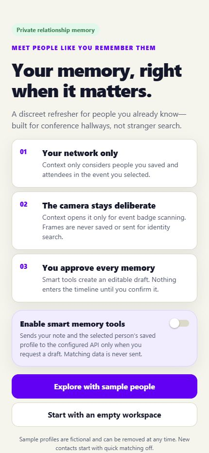
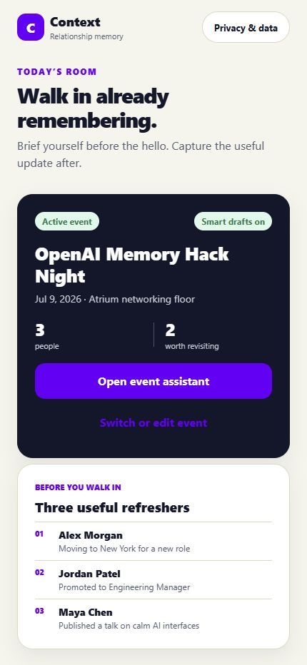
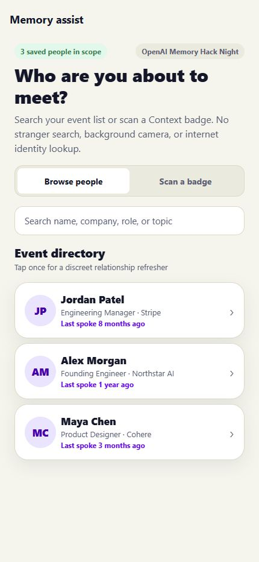
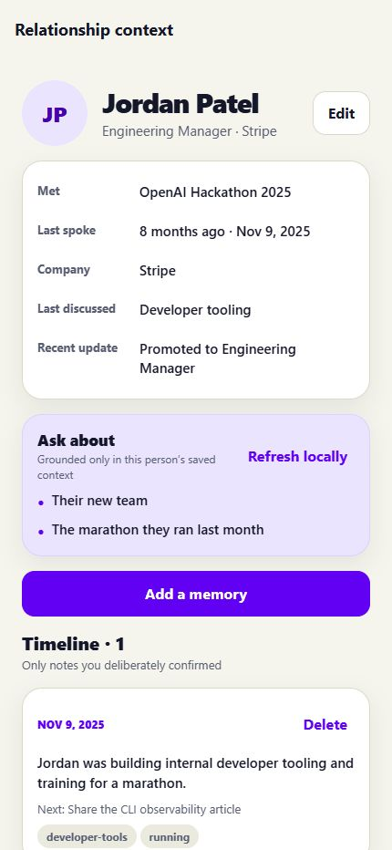
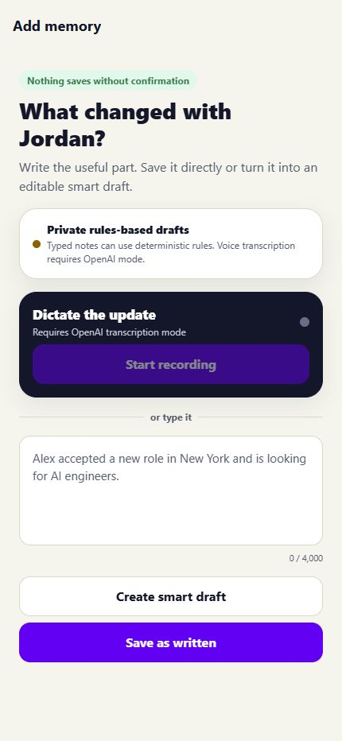
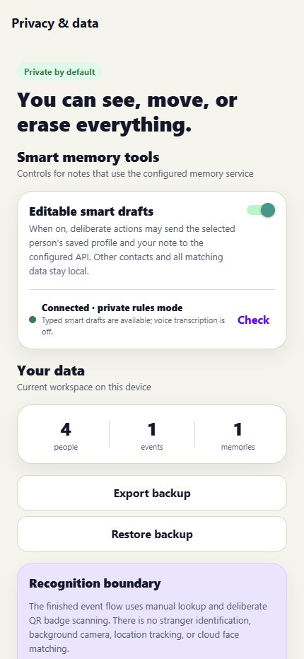
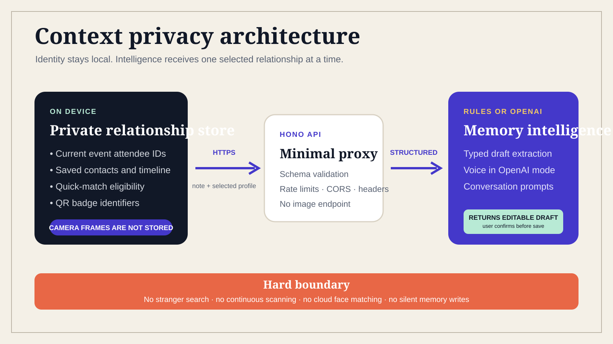

# Context

An offline relationship-memory app for the people you already know. Save where you met, what you discussed, and the details you want to remember.

[Product tour](#product-tour) · [Privacy](PRIVACY.md) · [Security](SECURITY.md) · [Deployment](docs/DEPLOYMENT.md)

## Development

I built Context with Codex as an AI engineering collaborator. I set the product direction, chose the privacy boundaries, reviewed changes, and tested the native and cross-platform flows. AI coding tools are part of development; the app does not require an OpenAI account or send relationship data to them at runtime.

## Product tour

<table>
  <tr>
    <td align="center"><strong>Private onboarding</strong></td>
    <td align="center"><strong>Relationship home</strong></td>
    <td align="center"><strong>Event assistant</strong></td>
  </tr>
  <tr>
    <td></td>
    <td></td>
    <td></td>
  </tr>
  <tr>
    <td align="center"><strong>Person profile</strong></td>
    <td align="center"><strong>Memory timeline</strong></td>
    <td align="center"><strong>Privacy controls</strong></td>
  </tr>
  <tr>
    <td></td>
    <td></td>
    <td></td>
  </tr>
</table>

## What Context can do

### Remember people

- Keep one private People directory with relationship context, contact fields, social links, profile photos, and confirmed memories.
- Add anyone directly or organize people into work, school, community, travel, and event lists.
- Search an everyday relationship refresher or open an event briefing ordered by who may need context.
- Review a chronological memory timeline and conversation prompts for each person.

### Capture context quickly

- Add a person or memory manually.
- Dictate a person description or memory while the visible Dictate control is active.
- Import selected iPhone Contacts through a review-first flow.
- Import validated CSV or people-list PDF files with duplicate protection.
- Turn rough notes into editable smart drafts before saving anything.

### Share intentionally

- Share selected public contact fields as a vCard through an offline QR code.
- Use the iOS share sheet, including AirDrop when iOS offers it.
- Scan and review a received contact card before adding or merging it.
- Keep memories, relationship notes, events, photos, and internal identifiers out of shared cards.

### Stay in control

- Protect the app with optional Face ID or device authentication.
- Export and restore a validated JSON backup.
- Delete one memory, remove one person and related data, or erase the complete workspace.
- Review public Update Watch suggestions before they become memories.

## Privacy by architecture

<p align="center">
  
</p>

The iOS and Android app has no hosted backend, paid API, API key, subscription, or usage meter.

- Contacts, events, preferences, and confirmed memories remain in the platform app sandbox.
- iPhone Contacts import copies only fields the user reviews. It never copies Contacts notes, birthdays, postal addresses, or photos, and it never changes the system address book.
- The camera opens only for deliberate QR scanning. Frames are not captured, stored, or uploaded.
- The microphone runs only during visible dictation. Audio is never saved or uploaded by Context.
- Face ID protects access to the app. Context receives only the operating system's success or failure result, never biometric data.
- Update Watch checks only a public HTTPS source the user confirms. Results remain in a review queue.
- Biometric identity matching is disabled. The released experience uses manual search and deliberate contact-card QR scanning.

See [PRIVACY.md](PRIVACY.md) for the complete data-handling model and [SECURITY.md](SECURITY.md) for security boundaries.

## On-device intelligence

On iOS, Context can optionally use Google's Gemma 4 E2B IT model through LiteRT-LM 0.14.0 for:

- Person field filling from one dictated description
- People-list PDF extraction
- Smart memory drafts
- Conversation prompts

Inference stays inside the app process. Every generated or extracted record is editable and requires review before it is saved. If the model is disabled, unavailable, or unable to complete a supported task, deterministic TypeScript assistance keeps the core workflow usable.

The model is an optional 2.59 GB download. Context verifies it with a pinned SHA-256 hash and keeps the model artifact separate from relationship backups.

The optional PC web companion can use `qwen3:4b` through a loopback-only Ollama runtime. This enhancement is not required by the native app and is never contacted by an iPhone.

## Technology

| Area | Implementation |
| --- | --- |
| Mobile and web | Expo 57, React Native 0.86, Expo Router, React 19 |
| Language and state | Strict TypeScript, Zustand, Zod |
| Native iOS | Swift, Objective-C bridges, LiteRT-LM, PDFKit, Speech, LocalAuthentication |
| Local AI | Gemma 4 E2B IT on iPhone, optional Qwen3 through local Ollama on PC |
| Sharing and import | vCard, QR, Contacts, CSV, PDF, JSON backup |
| Desktop | AppKit and WebKit wrapper for the production web bundle |
| Quality | Vitest, Node test runner, TypeScript, Expo Doctor, GitHub Actions |
| Development workflow | GPT-5.6 through Codex for assisted design, implementation, testing, debugging, and documentation |

## Repository layout

```text
apps/
  mobile/          Expo app for iOS, Android, and web
  desktop-macos/   Native macOS wrapper for the production web build
packages/
  shared/          Contracts, matching, parsing, backup, and assistance logic
docs/              Architecture, deployment, and release documentation
submission/        Demo, pitch, screenshots, and hackathon materials
tools/             Local model and Update Watch services and tests
```

## Run locally

### Requirements

- Node.js 22.23.1, also recorded in `.nvmrc`
- npm 10 or newer
- macOS with Xcode 26.4 or newer for iOS development
- An iOS 16.4 or newer simulator or device

### Install and verify

```bash
nvm use
npm ci
npm run verify
cd apps/mobile
npx expo-doctor
npx expo install --check
```

### Start the app

```bash
npm run dev:mobile
```

From the Expo terminal, choose iOS, Android, or web. For the native iOS project:

```bash
cd apps/mobile
npm run ios:native
```

QR scanning and dictation permissions require a physical device for final testing. See [docs/DEPLOYMENT.md](docs/DEPLOYMENT.md) for simulator, signed-device, EAS, TestFlight, and App Store instructions.

## Optional local PC assistance

```powershell
npm ci
ollama pull qwen3:4b
npm run dev:watcher
```

In a second terminal:

```powershell
npm --workspace @context/mobile run web
```

The service listens only on `127.0.0.1:8789` and contacts Ollama only on `127.0.0.1:11434`. It does not write AI prompts or model output to the watcher data file.

An optional Windows task can perform monthly catch-up checks for user-confirmed public sources:

```powershell
npm run install:update-task
```

Update Watch does not bypass authentication, CAPTCHAs, robots policies, or platform restrictions. RSS and Atom feeds, personal sites, public blogs, company newsrooms, GitHub feeds, and permitted public pages work best.

## Verification

```bash
npm ci
npm run verify
cd apps/mobile
npx expo-doctor
npx expo install --check
npm run export:ios -- --clear
npm run export:web -- --clear
CI=1 npx expo prebuild --platform ios --clean --no-install
```

GitHub Actions repeats the clean install, type checks, full test suite, Expo diagnostics, production exports, clean iOS prebuild, privacy-manifest validation, and permission-string assertions on Linux and macOS.

## Documentation

- [Privacy policy](PRIVACY.md)
- [Security policy](SECURITY.md)
- [Third-party notices](THIRD_PARTY_NOTICES.md)
- [Deployment guide](docs/DEPLOYMENT.md)
- [iOS release checklist](docs/IOS_RELEASE_CHECKLIST.md)
- [Biometric research gates](docs/FACE_MODEL_INTEGRATION.md)
- [Project story and Built with tags](submission/project-story.md)
- [Two-minute demo](submission/demo-script.md)
- [Submission checklist](submission/submission-checklist.md)

